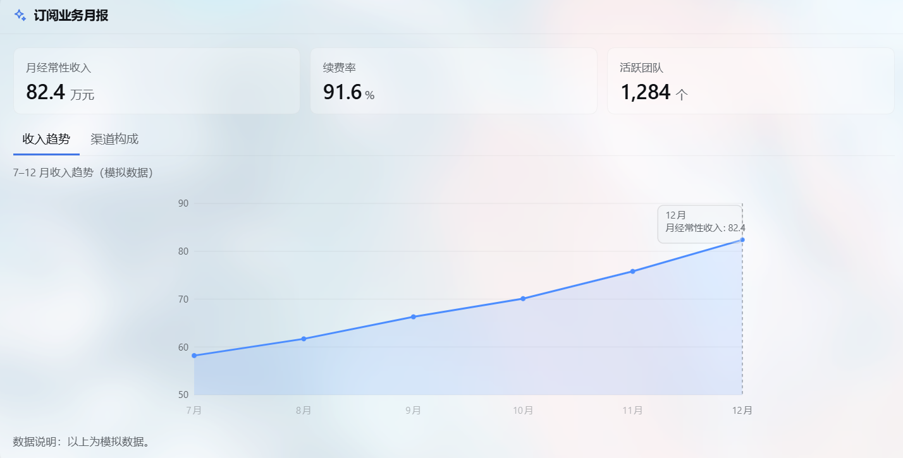
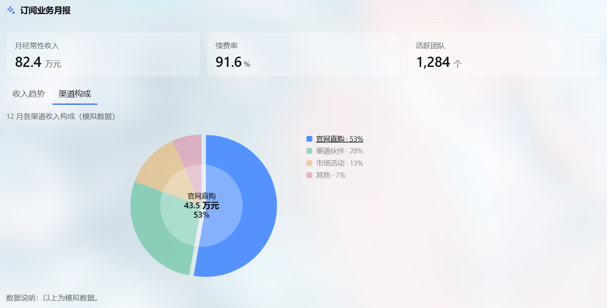
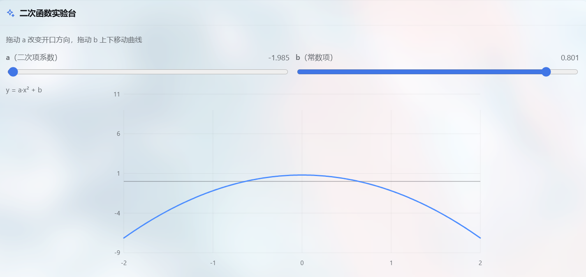
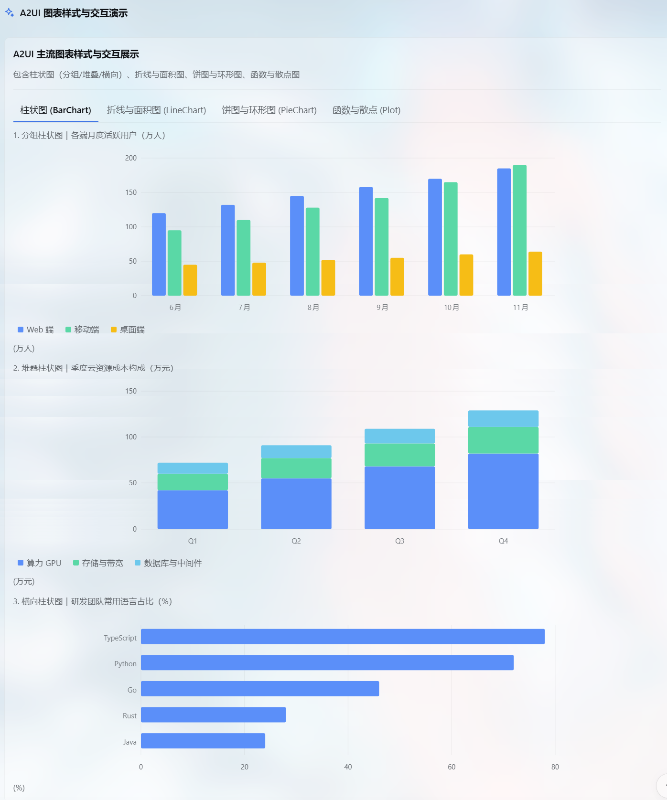
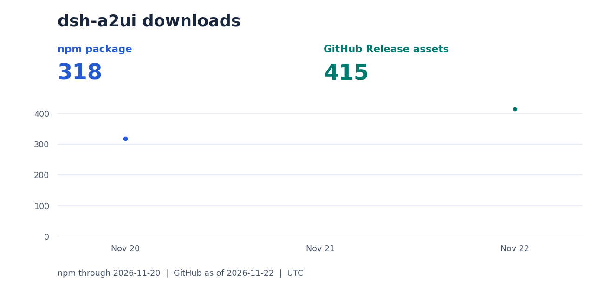

# dsh-a2ui — Answer-first A2UI for DeepSeek Harness

> **Make data-heavy AI answers easier to understand.**
> *Let the agent answer with an inline, on-demand A2UI surface when a picture explains better than a paragraph.*

[](./CHANGELOG.md)
[](https://google.github.io/a2ui/)
[](./docs/TEST-REPORT.md)
[](./docs/TEST-REPORT.md)
[](https://github.com/awesome-dsh-plugin/awesome-dsh-plugin)

[简体中文](./README.md) | [Changelog](./CHANGELOG.md) | [Architecture](./docs/ARCHITECTURE.md) | [Test report](./docs/TEST-REPORT.md)

**dsh-a2ui** is a DeepSeek Harness (DSH) plugin built on the Google A2UI 1.0 protocol that gives ordinary AI conversations **on-demand visual interfaces**.

When an answer contains **data comparisons, statistical trends, numeric relationships or algorithm walk-throughs**, the agent can draw sortable tables, charts, KPI cards and lightly interactive components directly in the conversation; simple questions still get plain Markdown.

Its goal is **not** to build a persistent dashboard or an app workbench. It is to **pick the right form for each answer (Answer-first, not dashboard-first)**.

### Core traits

| Trait | What it means |
| :--- | :--- |
| **Visuals on demand** | The agent decides from the answer whether a surface is worth drawing; the user does not have to type a special command |
| **A2UI 1.0 protocol** | Standard messages and 26 controlled components, validated against the published schema; no raw HTML injection |
| **Component-level progressive render** | As the model streams the tool arguments, each closed JSON value and component can appear, instead of a long blank wait |
| **Lightweight interaction loop** | Table sorting, chart hover and slider adjustments run locally; when needed, an `agent -> UI -> agent` action sends the operation back |
| **History stays honest** | One self-contained snapshot per call; the UI is re-rendered from the session log with no cross-turn state to maintain |

---

## Demo

[Watch the dsh-a2ui introduction on Bilibili](https://www.bilibili.com/video/BV1SNsb6fERN/)

### Subscription dashboard

Review subscription metrics and switch between revenue trends and channel breakdowns in a single card. The screenshots use sample data.





### Interactive quadratic plot

Drag the sliders to change the quadratic coefficient and constant. The plot updates immediately in the card.



### Bar chart layouts

Grouped, stacked, and horizontal bar charts in one tab.



---

## Download trends



Updated daily. The npm series covers the whole package, and the GitHub series counts the plugin's `.tgz` assets across releases. [Source data](https://github.com/ChimeSky/dsh-a2ui/blob/download-stats/history.json)

---

## Quick start

### 1. Install

The plugin ships as a bundle (`dsh.bundle` + `dsh.client`): the repository root is the installable package, and the build artifacts are committed, so installing does not compile anything.

- **In DSH (recommended)** — Open Plugins → Add plugin, enter `dsh-a2ui`, and click Install. DSH uses the selected registry's `latest` tag by default. Enter `dsh-a2ui@0.3.1` to request a specific version. [npm package](https://www.npmjs.com/package/dsh-a2ui)
- **From GitHub** — `dsh plugin --profile desktop add github:ChimeSky/dsh-a2ui#v0.3.1`
- **Offline install** — Run `npm pack dsh-a2ui` to download the `.tgz`, then enter its absolute path in Add plugin. To install the frozen tarball from this repository, use `dsh plugin --profile desktop add <absolute path>/vendor/dsh-a2ui-0.3.1.tgz` or run `tools/install.ps1`.
- **DSH plugin manager**: `plugin_manager action=install_bundle target=<absolute path or tarball>`

Replace `desktop` with the target profile (usually `web` for the web build). Replacing an installed package requires a DSH restart to load the new JavaScript module generation.

### 2. Just ask

No "draw a chart" or "make a table" instruction is needed. When an answer is better shown than read, the agent generates a surface; simple questions stay prose.

Tables sort by clicking a header, charts respond to hover and legend toggles, sliders and animations redraw locally. Only an `action.event` button or a form submit sends a user message back to the agent.

### 3. Build from source (optional)

```bash
git clone https://github.com/ChimeSky/dsh-a2ui.git
cd dsh-a2ui
npm install --ignore-scripts
npm run build
npm run all
```

`npm run all` runs typecheck, build, tests, bundle invariants, the real-React render check and the fresh-home install check.

---

## How it decides

The guidance tells the agent to decide from the answer's content, not from a user command:

| Answer content | Surface |
|---|---|
| 3+ comparable rows (options, versions, items, before/after) | `Table`; 2-4 headline numbers as a `Row` of `Stat` |
| Values over time, across categories or as shares | `BarChart` / `LineChart` / `PieChart` |
| Target, progress, coverage | `Progress` / `Stat` with trend |
| A value worth trying, or a formula | `Slider` + `Plot` bound to the data model |
| Discrete steps, ordering, algorithm walk-through | `FramePlayer` |
| Input or approval the user must give | form components + one submit/approve button |

**No surface** for: a single fact, a definition, yes/no, a greeting, a one-or-two-sentence explanation, code, diffs, logs, paths. Numbers a surface already shows are not repeated in prose.

The guidance is ~2.8 KB (~700 tokens) of always-on prompt; the full component reference loads on demand through `a2ui_catalog`.

## Design decision: one call, one self-contained snapshot

**One tool call, one self-contained UI snapshot.**

Each `a2ui` call produces one card that contains only that call's messages. **Updating an earlier card from a later call is deliberately unsupported** — a later turn cannot rewrite a surface that already appeared. The UI therefore sits in the transcript as a record, needs no cross-turn state, and replays predictably.

A2UI incremental messages still work: `createSurface → updateComponents → updateDataModel` **within one call** (including delete-then-create) compose correctly.

When a changed interface really must be shown, send a complete `createSurface` (components plus `dataModel`): the old card stays as it was and the new card shows the new state.

The cost is one extra card per change; the benefit is predictable replay and no cross-turn state.

## Interaction: local first

| Interaction | Behaviour |
|---|---|
| Chart hover | Bar / line / pie highlight the point and show an in-chart tooltip; the line chart adds a guide line and lists every series at that category; pie slices lift out and the centre shows that slice's value and share |
| Legend click | Shows/hides a series (local redraw) |
| Table header | Click to sort (asc, desc, off) with `aria-sort` |
| Tabs / sliders / animation | Switch, redraw, play/pause/step/speed — all local |
| `action.event` buttons | **Only these send a message and start a turn**; their hover text says so, and the prompt only allows them for an explicit submit/approve/refresh request |

The rule: anything the interface can do locally must not send a message. Only an `action.event` button or a form submit sends a normal user message, carrying the `context` resolved against the current data model.

Every component follows DSH's light/dark theme (`--dsw-alias-*` tokens), supports keyboard operation and ARIA labels; tables scroll horizontally and charts scale proportionally on narrow screens.

## Components

Default `catalogId` is `dsh-a2ui/catalog/v1` (everything below); the official basic catalog id is also accepted (first 18 only).

### Official basic catalog (18)

`Text`, `Image`, `Icon`, `Video`, `AudioPlayer`, `Row`, `Column`, `List`, `Card`, `Tabs`, `Modal`, `Divider`, `Button`, `TextField`, `CheckBox`, `ChoicePicker`, `Slider`, `DateTimeInput` — plus `checks` validation rules (`required`, `regex`, `length`, `numeric`, `email`) that disable the action button and show the message when they fail.

### Extension catalog (8)

| Component | Notes |
|---|---|
| `Table` | Column declarations + rows; number/currency/percent/date formatting, alignment, horizontal scroll, 40-row fold |
| `BarChart` | Grouped, stacked or horizontal bars |
| `LineChart` | Line, area, smooth curves, point markers |
| `PieChart` | Pie or donut with a percentage legend |
| `Stat` | KPI tile: value, unit, delta, trend colour |
| `Progress` | Progress bar with tone |
| `Plot` | Safe arithmetic function plot; `variables` may bind to the data model for local redraws |
| `FramePlayer` | Step animation (play/pause/step/reset/speed) over precomputed frames |

`Plot` expressions are evaluated by a **hand-written parser** that accepts only numbers, `x`, caller-supplied variables, `+ - * / ^ %`, parentheses and a closed set of math functions. Anything outside the whitelist fails to compile. No `eval`, no `new Function`.

### Bindings and functions

- Binding: `{"@path": "/json/pointer"}` (relative paths inside template items bind to the current row; a leading `/` is absolute).
- Function: `{"@call": "formatNumber", "args": {"value": {"@path": "/total"}, "decimals": 2}}`.
- Implemented official functions: `required`, `regex`, `length`, `numeric`, `email`, `formatString`, `formatNumber`, `formatCurrency`, `formatDate`, `pluralize`, `openUrl`, `and`, `or`, `not`, `@index`.
- `formatString` supports `${/path}`, `${formatNumber(value:/total, decimals:0)}`, `${'literal'}` and `\${` escaping.

## Sending an action back to the agent

Clicking an `action.event` button or submitting a form builds an A2UI 1.0 `action` message and sends a message starting with `[A2UI action]` through the **session's own Conversation service** as a normal queued user message. The payload carries `name`, `surfaceId`, `sourceComponentId`, `timestamp` and the `context` resolved against the current data model.

- **Native message path**: Host admission rules (running turn, queue limits, permissions) apply exactly as if the user had typed it; a surface cannot grant itself capabilities.
- Only `action.event` bothers the agent; `action.functionCall` (e.g. `openUrl`) runs in the browser.
- Replay never re-fires an action: it always takes a real click.

## Compatibility and protocol

| Item | Version |
|---|---|
| Verified on | **DSH 0.2.2-rc.1** (Desktop/Web, profile `desktop`) |
| `engines.dsh` | `>=0.2.2-rc.1 <0.3.0-0` |
| A2UI protocol | **1.0** (`version: "1.0"`; v0.8/v0.9 payloads are rejected with a clear message) |
| Spec source | v1.0 zod schemas + basic catalog in `@a2ui/web_core@0.15.0` (Apache-2.0) |
| Node | ≥ 20 (build requires `typescript`) |
| Browser side | only `react`, provided by the Harness module table |

Validation and rendering are **independent implementations of the A2UI 1.0 schemas**, not a call into the official runtime validator; message types, component names, properties and function signatures follow the published definitions, and extensions are declared through the standard catalog mechanism (`catalogId`), not a private format.

**Why the official `@a2ui/react` renderer is not used:** its basic catalog has no Table/Chart/Progress/Select (the chart catalog is unpublished), it ships Material-style components and CSS that would clash with `--dsw-alias-*` theming, and it adds `zod` + `markdown-it` to a single-file client bundle. The protocol layer, validator and action channel are therefore reimplemented from the schemas; swapping in the official renderer would mean replacing `src/client/surface.tsx` only.

## Security

| Risk | Handling |
|---|---|
| Model-authored HTML/script | All text is a React text node; inline Markdown only produces `<strong>/<em>/<code>/<br>`; `dangerouslySetInnerHTML` does not exist in the bundle |
| Arbitrary code execution | No `eval` / `new Function`; `Plot` uses a whitelist arithmetic parser |
| Hostile URLs | `safeMediaUrl` admits only `http(s)` (plus `data:image/*;base64` for images); `javascript:`, `file:`, `data:text/html` are rejected; `openUrl` requires a user gesture |
| Unknown components/properties | Rejected at validation with a JSON path; the renderer additionally degrades to a readable placeholder instead of throwing |
| Oversized/deep/cyclic graphs | 32 messages, 300 components per message, 400 per surface, depth 64, 16K strings, 500 series points, 400 frames, 384K payload; cycle and duplicate-id detection |
| Expanded-size budget | Before rendering, expanded nodes and data units are estimated: one surface above 4000 nodes or 5000 units, or one call above 6000 / 6000, is rejected. Host and client share the estimator |
| Catastrophic regex | `regex` runs the specification's static safety check and rejects backreferences, lookbehind, named groups, `\p{...}`, `\cX` and inline flags; input is capped at 4096 code points and matching runs on a bounded evaluator |
| Deep JSON | `isJsonValue` is iterative and bounded at 128 levels, checked before serialization: an 11,000-level array is rejected instead of overflowing the stack |
| Hostile JSON Pointers | Path ≤ 1024 chars, ≤ 64 segments, array index ≤ 10000, no prototype segments, sparse writes refused, `-` append supported; a refused write is reported at `updateDataModel.path` |
| Privilege escalation | A surface can only ask the agent for work through a normal user message; files/commands/network still go through the agent's tools and approvals |
| Plugin isolation | Every registration is owned by `ctx.effect`; disabling removes the view, styles, dictionaries, tools and prompt section |

Trade-off: `Image` accepts `https://` URLs, so rendering causes a request to that host (no credentials, `referrerPolicy="no-referrer"`). For a fully offline setup, use `data:` images only.

## Design boundaries and known limitations

### Deliberately unsupported

- **Updating an earlier card from a later call**: see [Design decision](#design-decision-one-call-one-self-contained-snapshot).
- **`callRendererFunction` / `agentFunctionResponse`**: A2UI 1.0 bidirectional function calls need an agent→renderer reply channel between tool calls, which the tool model does not provide; sending them yields an explicit error.

### Known limitations

- **The streamed preview is an intermediate state**: during `preparing` only closed components are drawn, the whole graph is not validated and the card is not interactive; when the call reaches `start`/`result` the validated snapshot replaces it. If the prefix stops parsing the preview falls back to the skeleton and the Host still reports the precise error.
- **PTC / code mode**: `run_code` sub-calls render as nested rows without dedicated styling.
- **Media needs the network** except `data:` images.
- **Relative bindings inside template items are read-only**; editing requires an absolute `/...` path.
- **`regex` has a match work limit**: accepted patterns run on a bounded evaluator capped at 100,000 steps per match; hitting the cap returns `valid: false` (common shapes are unaffected).

## Architecture

```text
DeepSeek Agent
   │  a2ui({ messages, title })
   ▼
Host  ──  A2UI 1.0 schema validation (surface / component / property / binding / depth / quota)
   │      tool result { ok, surfaces, warnings }; a replay copy is kept in result meta
   ▼
Session log (tool/call + tool/result.meta)   ← single source of truth
   │
   ▼
Client ── tool.call.toolview(key="a2ui")
   │      1. read args (or meta)
   │      2. validate again + applyMessageBatch → SurfaceState
   │      3. render the component tree against a local data model
   ▼
Chat UI (multiple surfaces per card)
   │  click / submit
   ▼
conversation.send("[A2UI action] …")  →  current session → agent
```

Three implementation constraints:

1. **The UI is the log.** One tool call is one snapshot; the renderer folds only that call's messages. No private store, restore is a re-render.
2. **Validate twice, implement once.** `src/shared` is imported by both halves, so "server accepts, browser crashes" cannot happen.
3. **Zero runtime dependencies.** The browser half only `require`s `react`; charts are hand-written SVG (no CDN, no chart library, offline-capable).

Streaming recovery, fragment cache bounds, card hosting and copy claims are documented in [docs/ARCHITECTURE.md](docs/ARCHITECTURE.md).

## Development and tests

```bash
npm install --ignore-scripts     # typescript/@types + react/react-dom/jsdom (test and render checks only)
npm run typecheck                # tsc --noEmit
npm run build                    # tsc + module linker → index.js, lib/**, client.js (written into the repo root)
npm test                         # all cases (node:test, in-process; includes the jsdom DOM cases)
npm run verify                   # pre-install bundle invariants
npm run render                   # real-React render check over in-repo fixtures (no network)
npm run pack:vendor              # regenerate vendor/dsh-a2ui-<version>.tgz
npm run all                      # all of the above
```

Current scale: 171 automated cases (18 jsdom DOM cases, 27 streaming cases, 43 official examples), 19 real-React render cases and 32 bundle invariants. Details and the split between "verified in a real DSH" and "verified headlessly only" are in [docs/TEST-REPORT.md](docs/TEST-REPORT.md); per-version changes are in [CHANGELOG.md](CHANGELOG.md).

`index.js`, `lib/**` and `client.js` are build artifacts committed to the repository so that `dsh plugin add github:` works without a build step; rerun `npm run build` and commit after changing `src/`. The build never deletes a file and does not use esbuild (the sandbox refuses its native service pipes).

## License and attribution

- This plugin: MIT (see [LICENSE](LICENSE)).
- A2UI specification, catalog ids and component/function names: A2UI project, Copyright 2024 Google LLC, Apache-2.0. No upstream source code is copied; the validator and renderer are independent implementations of the published schemas. See [NOTICE](NOTICE).
- The DSH integration uses public extension points only; no Harness source is modified or vendored.
